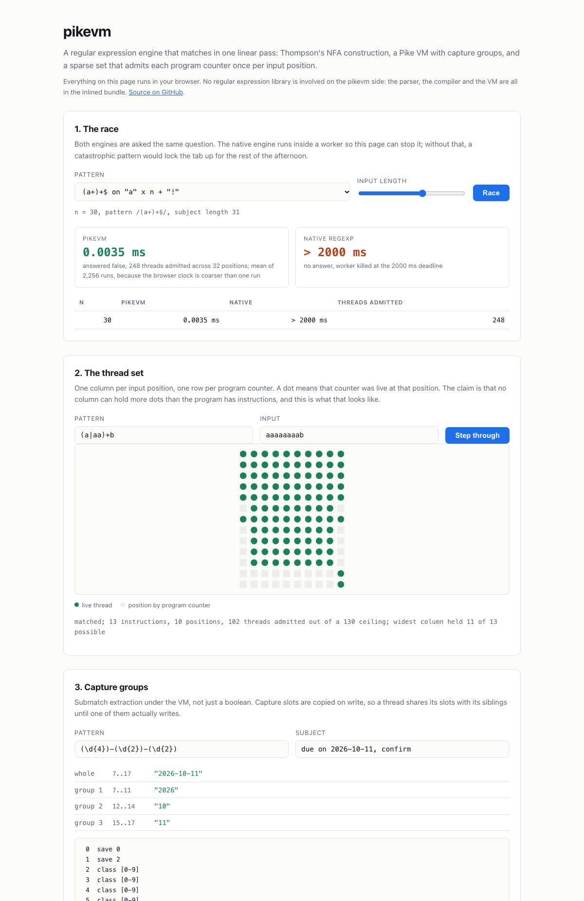

# pikevm

[](https://github.com/janeulzhan/pikevm/actions/workflows/ci.yml)

A regular expression engine that matches in a single left-to-right pass: a recursive-descent parser, Thompson's NFA construction, and a Pike VM with capture groups. No regular expression library is involved anywhere in the implementation, the tests, or the demo.

The interesting part is not that it works. It is that the thing it does differently from the engine already in your runtime is the thing that engine gets wrong.

## The frontier

A backtracking engine, which is what `RegExp` is in every mainstream runtime, explores an exponential number of ways to split the input between two nested quantifiers before it can conclude that nothing matches. These four patterns are the standard demonstration. The native engine is run in a child process and killed at the cutoff, because a catastrophic `RegExp` call cannot be interrupted any other way.

<!-- table:redos -->
| pattern | input length | pikevm | native `RegExp` | threads pikevm admitted |
| --- | ---: | ---: | ---: | ---: |
| `^(a\|aa)+$` | 33 | 0.0041 ms | 185.15 ms | 393 |
|  | 37 | 0.0051 ms | 1.2 s | 441 |
|  | 41 | 0.0050 ms | **> 2000 ms**, killed | 489 |
|  | 100,001 | 12.86 ms | **> 2000 ms**, extrapolated to ~10^20435 years | 1,200,009 |
| `(a+)+$` | 21 | 0.0019 ms | 40.09 ms | 168 |
|  | 25 | 0.0024 ms | 665.01 ms | 200 |
|  | 29 | 0.0028 ms | **> 2000 ms**, killed | 232 |
|  | 100,001 | 8.62 ms | **> 2000 ms**, extrapolated to ~10^29979 years | 800,008 |
| `(x+x+)+y` | 20 | 0.0023 ms | 18.26 ms | 200 |
|  | 24 | 0.0035 ms | 288.22 ms | 240 |
|  | 28 | 0.0034 ms | **> 2000 ms**, killed | 280 |
|  | 100,000 | 11.67 ms | **> 2000 ms**, extrapolated to ~10^29992 years | 1,000,000 |
| `^(a?){n}a{n}$` | 27 | 0.0287 ms | 0.0177 ms | 2,519 |
|  | 29 | 0.0326 ms | 0.0194 ms | 2,879 |
<!-- /table:redos -->

Same question, same answer, different asymptotics. The right-hand column is the reason: it counts the threads the VM admitted, and it grows linearly with the input while the native engine's running time does not.

Three of those four. The fourth, `^(a?){n}a{n}$`, is in every ReDoS cheat sheet and V8 is simply not vulnerable to it: it handles counted quantifiers by a different route and answers in microseconds, faster than this engine does. It is in the table because dropping it would have made the other three look like the whole story.

The extrapolated cells are labelled and are not measurements. They continue the growth factor fitted from the measured points, which is why they come out as powers of ten rather than as a duration; the honest reading is "this does not finish".

These are wall-clock numbers measured on the hardware named at the bottom of this file. CI does not check them, and cannot: a shared runner has no business making timing claims. What CI checks instead is the thread count, which is identical on every machine.

## The guarantee

Each input position owns one sparse set over program counters, and a counter may enter that set at most once. So for an input of length `n` and a program of `p` instructions, the whole run performs at most `(n + 1) * p` units of work, whatever the pattern.

That bound is asserted structurally, in [`test/linearity.test.ts`](test/linearity.test.ts), by instrumenting the VM to count admitted threads and comparing the count against `(n + 1) * p` across a matrix of adversarial patterns and input sizes. A stopwatch assertion would be flaky on a shared runner and would prove nothing about the algorithm; a count is exact and reproducible.

The same guard is why an empty loop body terminates. `/(a*)*b/` has no special case anywhere in this codebase: the second visit to the loop head at a given input position is simply refused, so the thread dies instead of spinning. Linearity and empty-loop termination are one mechanism, not two.

Compiled program sizes, which the bound depends on, are published and gated:

| pattern | instructions |
| --- | ---: |
| `a` | <!--bench:vm.programs.literal-a-->4<!--/bench--> |
| `a+` | <!--bench:vm.programs.plus-->5<!--/bench--> |
| `\d+` | <!--bench:vm.programs.digits-->5<!--/bench--> |
| `(\d{4})-(\d{2})-(\d{2})` | <!--bench:vm.programs.date-->19<!--/bench--> |
| `^(a\|aa)+$` | <!--bench:vm.programs.alt-nested-->14<!--/bench--> |
| `(a*)*b` | <!--bench:vm.programs.empty-star-->18<!--/bench--> |

## Live demo

**<https://janeulzhan.github.io/pikevm/>**

[](https://janeulzhan.github.io/pikevm/)

Three things, all running the same engine this repository ships, compiled into one self-contained page with no external requests:

1. **The race.** Pick a pattern and an input length and watch both engines answer. The native one runs inside a worker so the page can stop it at a deadline; without that, a catastrophic pattern would lock the tab up.
2. **The thread set.** One column per input position, one row per program counter, a dot for every live thread, animated as the VM steps. "At most `p` threads per column" stops being a claim you have to take on faith.
3. **Capture groups,** with the disassembled program next to them.

## Quickstart

```sh
git clone https://github.com/janeulzhan/pikevm
cd pikevm
npm ci
npm test
```

Node 24 or newer. It runs the TypeScript directly, so there is no build step and the only dependency is `esbuild`, used solely to bundle the demo page.

```js
import { Regex } from "./src/index.ts";

const re = new Regex("(\\d{4})-(\\d{2})-(\\d{2})");
re.test("due on 2026-10-11");          // true
re.exec("due on 2026-10-11").slices;   // ["2026-10-11", "2026", "10", "11"]
re.exec("due on 2026-10-11").groups;   // [[7, 17], [7, 11], [12, 14], [15, 17]]
re.stats.addsPerformed;                // threads admitted on the last run
```

Other entry points:

```sh
npm run bench            # the race, writes bench/results.json
npm run bench:ci         # the deterministic half, which CI gates
npm run fuzz -- --iters 1000000 --progress 100000   # the local sweep, writes nothing
npm run sync:readme      # redraw the wall-clock tables from bench/results.json
npm run build:demo       # rebuild docs/index.html
npm run benchlock:check  # verify every published figure against the tools
```

## How it works

A recursive-descent parser turns the pattern into a syntax tree, and Thompson's 1968 construction turns that tree into a flat program over six opcodes, `char`, `class`, `split`, `jump`, `save` and `match`, plus three zero-width ones that ECMAScript compatibility needs and that consume no input: `assert`, `clear` and `fail`. The VM, which is Rob Pike's design from the `sam` editor and is laid out most clearly in Russ Cox's writeups, keeps two lists of threads and advances all of them in lockstep over a single pass of the input: for each character it steps every thread in the current list, and each one that survives is filed into the next list along with its epsilon closure. The closure is followed iteratively with an explicit stack, and every program counter it reaches is checked against a Briggs-Torczon sparse set before it is expanded, so a counter can enter a list at most once per position. Branch priority is encoded in the argument order of `split`, and the thread lists preserve insertion order, so the first thread to reach `match` is the highest-priority one: that gives leftmost-first semantics, the same preference order a backtracking engine has, rather than POSIX leftmost-longest. Capture slots ride along with each thread and are copied on write, so a thread shares its slots with its siblings until one of them actually writes.

Two ECMAScript rules are backtracking artefacts that a textbook Pike VM does not reproduce, and both had to be implemented for the capture positions to match the oracle. An iteration of a quantifier past its declared minimum must consume input, which is why `/(a?)*/` on `""` leaves its group unset. And the capture slots of every group inside a quantifier are cleared at the start of each iteration, which is why `/(?:(a)|b)+/` on `"ab"` leaves group one unset rather than holding the `a` from the first iteration. The second is a `clear` instruction. The first is more interesting: the obvious implementation, a per-quantifier register holding where the iteration began, is **unsound in a thread-deduplicating VM**, because two threads can reach the same program counter at the same position holding different register values and the sparse set keeps only one of them. A million-pair sweep of the register-based version lost six matches that way, which is exactly the kind of fault a differential fuzz finds and inspection does not. The fix is to put the bit in the program counter instead of in a register: the loop body is emitted twice, once for "this iteration has consumed nothing yet" and once for "this iteration has consumed something", with every consuming instruction in the first copy transferring into the second. Every thread at a given counter then has the same future, and deduplication is sound again. [`src/compile.ts`](src/compile.ts) carries the construction and the reasoning.

- Ken Thompson, "Programming Techniques: Regular expression search algorithm", CACM 11(6), 1968.
- Rob Pike, the regular expression VM in the `sam` text editor, 1987.
- Russ Cox, "Regular Expression Matching Can Be Simple And Fast" (2007) and "Regular Expression Matching: the Virtual Machine Approach" (2009).
- Preston Briggs and Linda Torczon, "An Efficient Representation for Sparse Sets", LOPLAS 2(1-4), 1993.

## Differential fuzz against V8

Self-testing an engine against your own expectations tests your expectations. So the engine is tested against the one already in the runtime: a backtracking implementation with completely different internals that every reader already trusts. A seeded generator walks the supported grammar, a second one generates inputs over a small alphabet so that matches are frequent, and both engines are asked the same question. The generator is `mulberry32` with a fixed seed, so any pair is reproducible from two numbers.

Locally, one million generated pairs, with every capture span compared and no restriction on which patterns take part:

<!-- table:sweep -->
| comparison | pairs compared | pairs that agreed | share |
| --- | ---: | ---: | ---: |
| acceptance, `test()` against `RegExp.prototype.test` | 999,940 | 999,940 | 100.0000% |
| whole match span | 999,940 | 999,940 | 100.0000% |
| every capture group span | 999,940 | 999,940 | 100.0000% |
| the same, restricted to the conservative subset | 611,004 | 611,004 | 100.0000% |

Of the 1,000,000 pairs generated, 631,971 actually matched, and 512,867 distinct patterns carried capture groups. 60 pairs are excluded from every count above, because the platform engine does not return on them inside the 2000 ms deadline; they are listed in [`test/oracle-timeouts.json`](test/oracle-timeouts.json) and discussed below. The sweep took 110 seconds and found 0 disagreements.
<!-- /table:sweep -->

CI runs the same harness at <!--bench:fuzz.iterations-->25,000<!--/bench--> pairs, which takes about four seconds, and asserts that the number of disagreements is <!--bench:fuzz.divergenceCount-->0<!--/bench-->. In that CI-sized sweep, <!--bench:fuzz.acceptanceAgreed-->24,999<!--/bench--> of <!--bench:fuzz.acceptance-->24,999<!--/bench--> acceptance comparisons agree and <!--bench:fuzz.spanAgreed-->24,999<!--/bench--> of <!--bench:fuzz.spanCompared-->24,999<!--/bench--> capture span comparisons agree, with <!--bench:fuzz.matched-->15,966<!--/bench--> pairs actually matching so the sweep is not passing vacuously.

### What the oracle can and cannot settle

Capture positions are compared with the `d` flag, which makes the platform engine report real spans rather than just the matched text. Comparing text would be weaker, because two different spans can hold the same characters.

The span comparison began life restricted to patterns with no capture group under a quantifier, because those are exactly the patterns where the two ECMAScript rules described above bite. That restriction is no longer needed, but it is still computed and reported as the last row of the table, so a reader can see how much of the agreement rests on reproducing those rules rather than taking the claim on trust. The unrestricted and restricted rows both agree completely, which is the useful fact.

### The oracle does not always answer

A fuzz that explores the grammar freely wanders into catastrophic territory, and the oracle is a backtracking engine. Roughly one generated pair in seventeen thousand is one the platform engine does not return on at all: 60 of the million. That is not a nuisance to be filtered away: it is the same result as the table at the top of this file, found by a generator rather than picked from a list.

So the sweep runs in a worker thread with the supervisor watching a heartbeat, and a worker whose heartbeat stops for longer than the deadline is terminated and the pair it was on is recorded. Every one of them is in [`test/oracle-timeouts.json`](test/oracle-timeouts.json) with its seed and index, which keeps the agreement counts reproducible, and [`test/fuzz.test.ts`](test/fuzz.test.ts) asserts that this engine answers all of them in under five milliseconds. The first one the generator finds, at iteration 24,320, is:

```
/(((1{0,0})-{1,3} ?|$0_|([\w-]{0,2})*){3}){1,}(.^|0+|0b+_*)^/   on   "b00a1xc_0-c_-1bca__"
```

Nineteen characters, and a 346 instruction program. pikevm admits 3,576 threads and answers `false` in 0.05 ms; the platform engine does not answer.

## The twelve-pattern catalogue

The usual catastrophic-backtracking catalogue, timed on this engine. Wall-clock, measured locally, not CI-gated. [`test/redos.test.ts`](test/redos.test.ts) asserts the thread-count bound for each of these instead, which is the part that can be checked anywhere.

<!-- table:catalogue -->
| pattern | input length | pikevm | threads admitted |
| --- | ---: | ---: | ---: |
| `^(a\|aa)+$` | 41 | 0.0056 ms | 489 |
| `(a+)+$` | 41 | 0.0037 ms | 328 |
| `(a+)+b` | 40 | 0.0038 ms | 324 |
| `(x+x+)+y` | 40 | 0.0050 ms | 400 |
| `(a*)*b` | 2,000 | 0.2949 ms | 28,009 |
| `(a\|a?)+$` | 41 | 0.0098 ms | 918 |
| `([a-zA-Z]+)*$` | 41 | 0.0042 ms | 374 |
| `(a\|b\|ab)+c` | 48 | 0.0070 ms | 608 |
| `^(\w+\s?)*$` | 41 | 0.0052 ms | 489 |
| `(.*a){20}b` | 60 | 0.0825 ms | 7,272 |
| `^(a?){25}a{25}$` | 24 | 0.0234 ms | 2,024 |
| `((a)*)*b` | 500 | 0.0930 ms | 9,511 |
<!-- /table:catalogue -->

## What CI checks, and what it cannot

CI gates only quantities that are identical on every machine: differential fuzz agreement counts, capture span agreement counts, compiled program sizes, and admitted thread counts. Those figures live inside marker spans in this file, and `npm run benchlock:check` recomputes them and fails if a published number has drifted past the tolerance declared for its key. Disagreement counts carry zero tolerance. Agreement counts carry a 0.2% allowance for one reason only: which pairs the oracle fails to answer depends on how fast the machine is.

No wall-clock figure is gated. Every timing in this file comes from `bench/results.json`, is regenerated by `npm run sync:readme` rather than typed by hand, and is labelled with the hardware it was measured on. That is a weaker guarantee than benchlock gives the deterministic figures, and saying so is the point.

## Limitations

- **No backreferences and no lookaround.** These are not missing features, they are the price of the guarantee. Both require the matcher to remember and revisit, which is precisely what forces backtracking and what makes the exponential blowup possible. A pattern using either is rejected at parse time with a message saying so.
- **Leftmost-first only.** Match preference follows branch order, matching ECMAScript and Perl. There is no POSIX leftmost-longest mode.
- **Slower than the native engine on ordinary patterns,** and it should be. A general NFA simulation does bookkeeping per character that a backtracking engine tuned over two decades skips entirely. Measured:

<!-- table:ordinary -->
| pattern | input length | pikevm | native `RegExp` | pikevm is slower by |
| --- | ---: | ---: | ---: | ---: |
| `needle` | 180,006 | 4.92 ms | 0.0374 ms | 131.7× |
| `(\d{4})-(\d{2})-(\d{2})` | 20,010 | 0.7892 ms | 0.0397 ms | 19.9× |
| `^[a-z]+$` | 20,000 | 1.18 ms | 0.0310 ms | 38.0× |
| `[\w.]+@[\w]+\.[a-z]{2,4}` | 20,016 | 1.19 ms | 0.0409 ms | 29.0× |
| `a.*b.*c` | 5,003 | 0.1370 ms | 0.0217 ms | 6.3× |
<!-- /table:ordinary -->

  The trade is the whole point: a constant factor on the patterns that were never a problem, in exchange for a bound on the ones that were.
- **No flags.** No `i`, `m`, `s`, `u`, `y` or `g`. `.` excludes line terminators and `^`/`$` anchor to the whole input, matching the flagless default.
- **UTF-16 code units, not code points.** No `\p{...}` property escapes, and astral characters are two units.
- **Counted repetition expands by duplication,** capped at 10,000 instructions. `(ab|cd){4000}` is rejected with a clear error rather than being allowed to exhaust memory. A guarded quantifier emits its body twice, so the cap is reached sooner for deeply nested empty-matchable loops.
- **A `{` that does not begin a counted quantifier is a syntax error,** where ECMAScript's Annex B grammar treats it as a literal brace. This is the one place the supported language is deliberately narrower than the oracle's, and the fuzz generator never emits one.

## Provenance

<!-- table:provenance -->
Measured on Apple M4, 16 GiB, Node v24.19.0, 2026-10-11. The native engine is run in a child process and killed at 2000 ms, because a catastrophic `RegExp` call cannot be interrupted any other way.
<!-- /table:provenance -->

The committed `bench/results.json` and `bench/sweep-1m.json` are the actual output of `npm run bench` and `npm run fuzz`; every table above is rendered from them.

## License

MIT. See [LICENSE](LICENSE).
